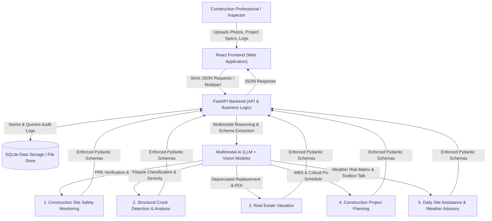

# Multimodal Construction Intelligence Platform

[](https://www.python.org/)
[](https://fastapi.tiangolo.com/)
[](https://react.dev/)
[](https://vitejs.dev/)
[](https://tailwindcss.com/)
[](LICENSE)

An intelligent, full-stack decision-support system designed to assist construction professionals across multiple stages of construction planning, execution, and monitoring. The platform leverages **multimodal artificial intelligence**, enabling it to analyze **textual inputs, job site images, and structured engineering data** to generate accurate, actionable, and context-aware insights.

Traditional construction management practices rely heavily on manual supervision, static documentation, and experience-based judgments. These methods often fail to provide real-time intelligence, integrated safety analysis, or automated planning support. To address these challenges, this platform integrates a modern **React.js frontend** with a high-performance **FastAPI-based Python backend**, powered by a multimodal large language model architecture with strict JSON-based data contracts.

---

## 🏗️ Technical Architecture



---

## ⚡ Key Capabilities

### 1. Construction Site Safety Monitoring
- **Visual PPE Compliance Auditing**: Automatically inspects job site images for hard hats (ANSI Z89.1), high-visibility reflective vests, steel-toe boots, eye protection, and fall harnesses.
- **Hazard Detection Engine**: Identifies tripping hazards, uncoiled high-voltage cables, unprotected floor openings, and scaffolding integrity risks.
- **Auditor Recommendations**: Automatically synthesizes corrective actions and personalized toolbox talk topics.

### 2. Structural Crack Detection and Analysis
- **Forensic Crack Diagnostics**: Classifies crack patterns into *Diagonal Structural Shear Cracks*, *Hairline Shrinkage Fissures*, *Foundation Settlement Fractures*, or *Thermal Expansion Cracks*.
- **Severity & Width Index**: Quantifies crack severity score (0–100) and assesses immediate risk to load-bearing columns and beams.
- **Engineering Repair Protocols**: Prescribes specific repair materials (e.g. low-viscosity ASTM C881 structural epoxy injection, CFRP wrap composite laminates).

### 3. Real Estate & Asset Valuation
- **Multi-Variable Valuation Model**: Synthesizes property typology, built-up area (sq. ft.), location tiers (Tier 1 Metro, Urban, Suburban), structural specification grades (Luxury, Standard, Economy), and building age.
- **Financial Projections**: Computes depreciated replacement cost, land component value, price-per-square-foot ranges, and projected annual ROI percentage.

### 4. Construction Project Planning & Work Breakdown Structure (WBS)
- **Automated Phase Scheduling**: Generates multi-phase construction schedules (Groundwork, Superstructure, MEP Rough-Ins, Interior Fit-Out, Commissioning) mapped across target durations.
- **Critical Path Method (CPM)**: Flags critical path activities, calculates duration in weeks, allocates budgets, and assigns contingency reserves.

### 5. Daily Site Assistance & Weather-Aware Advisory
- **Meteorological Risk Evaluation**: Analyzes temperature, wind velocity, humidity, and rainfall against high-risk trade operations (crane lifts, exterior concrete pouring, roofing).
- **Prohibited Activity Alerts**: Enforces safety shutdowns (e.g. stopping crane operations when wind gusts exceed 35 km/h).
- **Toolbox Talk of the Day**: Prepares daily site briefing topics for morning trade stands.

### 6. Engineering & Building Code Knowledge Assistant
- Interactive multimodal copilot referencing **OSHA 29 CFR 1926**, **IBC 2024**, **ACI 318-19**, and **ASTM standards**.

---

## 📁 Repository Structure

```
multimodal-construction-intelligence-platform/
├── backend/
│   ├── app/
│   │   ├── api/
│   │   │   ├── safety.py        # Site safety & PPE inspection endpoint
│   │   │   ├── cracks.py        # Crack classification & forensics endpoint
│   │   │   ├── valuation.py     # Real estate valuation endpoint
│   │   │   ├── planning.py      # Project planning & WBS endpoint
│   │   │   ├── advisory.py      # Weather-aware site advisory endpoint
│   │   │   ├── knowledge.py     # Engineering codes chat endpoint
│   │   │   └── reports.py       # Persistent audit history & API key config
│   │   ├── core/
│   │   │   ├── config.py        # System configuration & settings
│   │   │   └── ai_service.py    # Multimodal Gemini API + Heuristic engine
│   │   ├── models/
│   │   │   ├── schemas.py       # Pydantic schemas (Strict JSON contracts)
│   │   │   └── database.py      # SQLite models & session management
│   │   └── main.py              # FastAPI app factory & static mounts
│   ├── tests/
│   │   └── test_api.py          # Automated pytest suite (8/8 passing)
│   ├── requirements.txt         # Backend Python dependencies
│   └── .env.example             # Environment configuration template
├── frontend/
│   ├── src/
│   │   ├── components/
│   │   │   ├── Sidebar.jsx      # Navigation sidebar (SkillWallet themed)
│   │   │   ├── Navbar.jsx       # Header & live engine status indicator
│   │   │   ├── DashboardOverview.jsx # Executive blueprint & architecture view
│   │   │   ├── SafetyMonitoring.jsx  # PPE verification & hazard view
│   │   │   ├── CrackAnalysis.jsx     # Crack diagnostics & repair view
│   │   │   ├── RealEstateValuation.jsx # Property valuation view
│   │   │   ├── ProjectPlanning.jsx   # WBS & CPM schedule view
│   │   │   ├── DailyAdvisory.jsx     # Meteorological risk matrix view
│   │   │   ├── KnowledgeChat.jsx     # Construction codes chat copilot
│   │   │   ├── ReportsHistory.jsx    # SQLite audit record browser & modal
│   │   │   └── ConfigModal.jsx       # Runtime Gemini API key settings modal
│   │   ├── services/
│   │   │   └── api.js           # API client service
│   │   ├── App.jsx              # Main React container
│   │   ├── main.jsx             # React entry point
│   │   └── index.css            # Tailwind CSS styling
│   ├── package.json             # Frontend dependencies
│   ├── vite.config.js           # Vite configuration with API proxy
│   └── tailwind.config.js       # Tailwind CSS configuration
├── sample_data/
│   ├── create_samples.py        # Synthetic test image generator
│   ├── sample_safety_inspection.jpg
│   ├── sample_structural_crack.jpg
│   └── sample_commercial_building.jpg
├── setup_and_run.bat            # One-click Windows batch launcher
├── start.ps1                    # One-click PowerShell launcher
├── .gitignore                   # Comprehensive git exclusions
└── README.md                    # Project documentation
```

---

## 🚀 Quick Start Guide

### Prerequisites
- **Python**: Version 3.10+ (tested on Python 3.13)
- **Node.js**: Version 18+ (tested on Node v24)
- **Git**: For version control

---

### Option 1: One-Click Launch (Windows)
Double-click `setup_and_run.bat` or run:
```powershell
.\start.ps1
```
This automatically installs dependencies and starts both services:
- **Frontend Dashboard**: [http://localhost:5173](http://localhost:5173)
- **Backend API Interactive Docs**: [http://127.0.0.1:8000/docs](http://127.0.0.1:8000/docs)

---

### Option 2: Manual Setup

#### 1. Backend Setup
```bash
cd backend
python -m pip install -r requirements.txt
python -m uvicorn app.main:app --host 127.0.0.1 --port 8000 --reload
```

#### 2. Frontend Setup
In a new terminal:
```bash
cd frontend
npm install
npm run dev
```

---

## 🧪 Running Automated Tests

Run the full automated test suite verifying all 6 API modules and JSON contract schemas:

```bash
cd backend
python -m pytest tests/test_api.py -v
```

Expected output:
```
tests/test_api.py::test_health_check PASSED                              [ 12%]
tests/test_api.py::test_safety_inspection_endpoint PASSED                [ 25%]
tests/test_api.py::test_crack_analysis_endpoint PASSED                   [ 37%]
tests/test_api.py::test_real_estate_valuation_endpoint PASSED            [ 50%]
tests/test_api.py::test_project_planning_endpoint PASSED                 [ 62%]
tests/test_api.py::test_daily_advisory_endpoint PASSED                   [ 75%]
tests/test_api.py::test_knowledge_chat_endpoint PASSED                   [ 87%]
tests/test_api.py::test_reports_history PASSED                           [100%]
============================== 8 passed in 8.47s ===============================
```

---

## 🔑 AI Key Configuration

The platform operates in **dual-engine mode**:
1. **Adaptive Intelligence Engine (Default)**: Preloaded with certified structural heuristics, forensic formulas, and OSHA baseline rules. Works out of the box without requiring an API key.
2. **Google Gemini Live Multimodal**: Enter your Google Gemini API key via the **Settings** modal in the UI or by setting `GEMINI_API_KEY` in `backend/.env`.

---

## 📤 Upload to Your GitHub Account

To push this repository to your GitHub account:

1. **Create a new repository on GitHub**:
   - Go to [github.com/new](https://github.com/new)
   - Repository name: `multimodal-construction-intelligence-platform`
   - Set visibility to **Public** (or **Private**)
   - Do **NOT** initialize with README or .gitignore (these are already configured)
   - Click **Create repository**

2. **Run these commands in your project root**:
   ```bash
   cd C:\Users\user\.gemini\antigravity\scratch\multimodal-construction-intelligence-platform

   # Initialize git repository
   git init
   git branch -M main

   # Configure your git author identity
   git config user.name "Your Name"
   git config user.email "your.email@example.com"

   # Stage and commit all files
   git add .
   git commit -m "feat: complete multimodal construction intelligence platform"

   # Link to your new GitHub repository (replace with your repo URL)
   git remote add origin https://github.com/<YOUR-GITHUB-USERNAME>/multimodal-construction-intelligence-platform.git

   # Push to GitHub
   git push -u origin main
   ```

---

## 📄 License
This project is licensed under the MIT License - see the [LICENSE](LICENSE) file for details.
